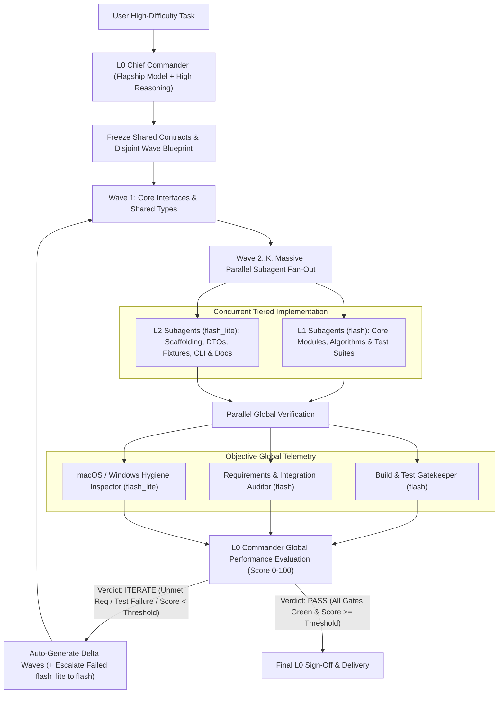

<a id="top"></a>

# Multi-Agent Skill — `apex-commander`

> 🌐 **Language / 语言**: **English** | **[简体中文 (Chinese)](./README.zh-CN.md)**

A cross-platform (**macOS & Windows**) hierarchical multi-agent orchestration skill for **Google Antigravity**. Designed for high-difficulty software architecture, multi-module engineering, and large-scale refactors: a **flagship model at maximum reasoning effort** acts strictly as the **Chief Architect & Commander**, dispatching waves of **`flash`** (1 tier weaker) and **`flash_lite`** (2 tiers weaker) parallel subagents, then scoring global performance against all user requirements to automatically drive multi-round closed-loop iterations.

---

## Table of Contents

- [1. Why `apex-commander`?](#overview)
- [2. Closed-Loop Architecture](#architecture)
- [3. Three-Tier Model Routing Policy](#model-tiers)
- [4. Quick Start Installation (macOS & Windows)](#quick-start)
- [5. How to Guarantee Skill Invocation](#guarantee-invocation)
- [6. Unattended Workflow Permissions Setup](#permissions)
- [7. Cross-Platform Design (macOS & Windows)](#cross-platform)
- [8. Repository Structure](#repo-structure)
- [9. Blueprint Configuration Reference](#blueprint-spec)
- [10. How to Verify It Is Running](#verification-signals)

---

<a id="overview"></a>
## 1. Why `apex-commander`?

When tackling complex multi-module engineering tasks with a single agent, flagship models burn time and context writing repetitive boilerplate while single-pass subagents often drift out of sync across module boundaries.

`apex-commander` solves both problems simultaneously:

- **Peak Reasoning Where It Matters**: Your strongest model at **High** reasoning intensity focuses 100% on system architecture, shared interface contracts, conflict-free file sharding, and global evaluation — never wasting tokens typing boilerplate.
- **Massive Parallel Implementation**: Independent modules, tests, fixtures, CLI adapters, and docs fan out concurrently across `flash` and `flash_lite` worker subagents via Antigravity's built-in `run_workflow` engine.
- **Collision-Free by Construction**: Automatically validates and partitions waves using case-insensitive path normalization (safe on both **macOS APFS** and **Windows NTFS**) so two concurrent subagents never overwrite the same file.
- **Autonomous Multi-Round Iteration**: After each implementation round, parallel gatekeepers run objective build/test commands, requirement coverage audits, and cross-platform checks. If global performance falls below threshold (default `95/100`) or any check fails, the Commander automatically synthesizes corrective tasks and launches Round `r + 1`.

---

<a id="architecture"></a>
## 2. Closed-Loop Architecture



---

<a id="model-tiers"></a>
## 3. Three-Tier Model Routing Policy

| Tier | Role | Antigravity `model` | Primary Responsibilities | Auto-Escalation Policy |
| :--- | :--- | :--- | :--- | :--- |
| **L0** | **Chief Architect & Commander** | `"inherit"` *(on Flagship High)* or `"pro"` | Architecture design, shared contracts, conflict-free DAG sharding, global multi-criteria scoring, iterative replanning | Writes explicit algorithmic specs into task contracts if L1 fails twice |
| **L1** *(1 tier weaker)* | **Core Builder** | `"flash"` | Core modules, complex domain/stateful logic, cross-file integration fixes, unit & integration test suites | Escalated to L0 contract refinement if blocked repeatedly |
| **L2** *(2 tiers weaker)* | **Rapid High-Concurrency Worker** | `"flash_lite"` | Codebase scouting, directory scaffolding, DTOs/types/configs, test mocks/fixtures, docs, static hygiene scans | Automatically escalated to **`"flash"`** in Round `r + 1` if failed or incomplete |

Detailed prompt contracts and fallback rules: [worker-prompt-contracts.md](./skills/apex-commander/references/worker-prompt-contracts.md).

---

<a id="quick-start"></a>
## 4. Quick Start Installation (macOS & Windows)

Clone this repository on your machine, then install globally into `~/.gemini/config/skills/apex-commander` so **every workspace** has access to `apex-commander`.

### Windows (PowerShell)

```powershell
git clone <your-repo-url> C:\Users\<YourName>\Documents\GitHub\multi-agent-skill
cd C:\Users\<YourName>\Documents\GitHub\multi-agent-skill

# Standard global skill installation
powershell -ExecutionPolicy Bypass -File .\install.ps1

# Recommended: also install the always-on auto-trigger routing rule into ~/.gemini/config/GEMINI.md
powershell -ExecutionPolicy Bypass -File .\install.ps1 -WithRule
```

### macOS / Linux (`zsh` or `bash`)

```bash
git clone <your-repo-url> ~/Documents/GitHub/multi-agent-skill
cd ~/Documents/GitHub/multi-agent-skill

# Standard global skill installation
bash ./install.sh

# Recommended: also install the always-on auto-trigger routing rule into ~/.gemini/config/GEMINI.md
bash ./install.sh --with-rule
```

### Other Installer Commands

| Action | Windows (`PowerShell`) | macOS / Linux (`zsh` / `bash`) |
| :--- | :--- | :--- |
| **Verify bundle & syntax only** | `python .\install.py --verify-only` | `python3 ./install.sh --verify-only` *(or `bash ./install.sh --verify-only`)* |
| **Uninstall global skill & rule** | `powershell -ExecutionPolicy Bypass -File .\install.ps1 -Uninstall` | `bash ./install.sh --uninstall` |
| **Team / Workspace-Scoped Setup** | Copy `skills/apex-commander` into `<project>/.agents/skills/apex-commander` | Copy `skills/apex-commander` into `<project>/.agents/skills/apex-commander` |

[⬆️ Back to Top](#top)

---

<a id="guarantee-invocation"></a>
## 5. How to Guarantee Skill Invocation

Antigravity loads skills via **Progressive Disclosure** (only `name` and `description` are preloaded into context until activated). Choose any of the three levels below depending on how deterministic you want activation to be:

1. **100% Deterministic Explicit Call**:
   - Mention `apex-commander` in your prompt, or pair it with `/goal` for long-running autonomous execution:
     ```text
     /goal Use apex-commander to architect and implement ...
     ```
2. **Always-On Global Routing Rule (`--with-rule` / `-WithRule`)**:
   - Running `install.ps1 -WithRule` or `install.sh --with-rule` idempotently adds [apex-commander-routing.md](./rules/apex-commander-routing.md) (bounded by `<!-- APEX-COMMANDER-RULE:START/END -->` markers so existing rules are untouched) into `~/.gemini/config/GEMINI.md`.
   - This acts as a tiny always-on gatekeeper instructing the model to **always** activate `apex-commander` whenever a task spans **3+ modules/files** or involves system architecture.
3. **Bilingual Semantic Auto-Activation**:
   - [SKILL.md](./skills/apex-commander/SKILL.md) includes both English and Chinese trigger descriptions so complex architectural prompts automatically match.

---

<a id="permissions"></a>
## 6. Unattended Workflow Permissions Setup

Inside `run_workflow`, background subagents **cannot prompt the user interactively** — any action requiring interactive approval that has not already been granted fails immediately (`ToolError.denied == True`).

For smooth, uninterrupted multi-round execution across dozens of subagents:

1. **Select a Flagship `(High)` Model** in **Model Selection** so L0 Commander runs at peak reasoning intensity.
2. Set **Tool Execution Policy** (in Global or Project Settings) to:
   - **`proceed-in-sandbox`** *(recommended default for standard repositories)*, or
   - **`always-proceed`** *(when compilers/tests require local build daemons, ports, or network access)*.
3. Add common build/test runners (`python`, `python3`, `pytest`, `node`, `npm`, `pnpm`, `cargo`, `go`, `sbt`, `gradle`, `mvn`, `dotnet`) to your **Command Allowlist**.

Full details: [cross-platform-and-permissions.md](./skills/apex-commander/references/cross-platform-and-permissions.md).

---

<a id="cross-platform"></a>
## 7. Cross-Platform Design (macOS & Windows)

`flash` and `flash_lite` workers frequently fail when guessing shell syntax across operating systems. `apex-commander` eliminates OS friction automatically:

- **Runtime OS & Shell Injection**: [auto_orchestrator.py](./skills/apex-commander/scripts/auto_orchestrator.py) detects `platform.system()` at startup and injects tailored shell rules (`PowerShell` on Windows vs. `zsh`/`bash` on macOS) into every worker prompt.
- **Windows Store `python3.exe` Shim Filtering**: [env_probe.py](./skills/apex-commander/scripts/env_probe.py) automatically filters 0-byte `Microsoft\WindowsApps\python3.exe` shims on Windows and routes CLI calls to `python` on Windows vs. `python3` on macOS.
- **Case-Insensitive Path Collision Protection**: Both macOS (APFS) and Windows (NTFS) are case-insensitive by default; the wave scheduler normalizes and case-folds `owned_files` before launching `parallel()` batches.
- **Line-Ending Hygiene**: [.gitattributes](./.gitattributes) and [install.py](./install.py) enforce `LF` on `.sh/.py/.md/.json` and `CRLF` on `.ps1` so transferring files between Windows and Mac never breaks `#!/usr/bin/env bash`.

---

<a id="repo-structure"></a>
## 8. Repository Structure

```text
multi-agent-skill/
├── README.md                                            # English documentation (you are here)
├── README.zh-CN.md                                      # Simplified Chinese documentation (简体中文)
├── install.py                                           # Cross-platform installer, verifier & rule injector
├── install.ps1                                          # One-click Windows PowerShell installer
├── install.sh                                           # One-click macOS / Linux installer
├── .gitattributes                                       # Cross-platform LF / CRLF line-ending rules
├── .gitignore                                           # Git ignore patterns
├── LICENSE                                              # MIT License
├── .agents/
│   └── skills.json                                      # Workspace skill manifest when opening this repo directly
├── rules/
│   └── apex-commander-routing.md                        # Optional always-on GEMINI.md auto-routing rule template
└── skills/
    └── apex-commander/
        ├── SKILL.md                                     # Core skill instructions & bilingual trigger metadata
        ├── examples/
        │   └── blueprint_example.json                   # Complete multi-wave conflict-free blueprint sample
        ├── references/
        │   ├── worker-prompt-contracts.md               # L0/L1/L2 routing rules, sharding & fallback mode
        │   └── cross-platform-and-permissions.md        # macOS vs Windows matrix & unattended permission setup
        └── scripts/
            ├── auto_orchestrator.py                     # Automated multi-round `run_workflow` closed-loop engine
            ├── env_probe.py                             # Cross-platform OS, shell & toolchain detector
            ├── install_global.py                        # Standalone skill-directory installer
            ├── install_mac.sh                           # Standalone macOS installer
            └── install_win.ps1                          # Standalone Windows installer
```

Quick file links:
- Core Skill: [SKILL.md](./skills/apex-commander/SKILL.md)
- Workflow Engine: [auto_orchestrator.py](./skills/apex-commander/scripts/auto_orchestrator.py)
- Environment Probe: [env_probe.py](./skills/apex-commander/scripts/env_probe.py)
- Example Blueprint: [blueprint_example.json](./skills/apex-commander/examples/blueprint_example.json)
- Routing Rule Template: [apex-commander-routing.md](./rules/apex-commander-routing.md)

[⬆️ Back to Top](#top)

---

<a id="blueprint-spec"></a>
## 9. Blueprint Configuration Reference

When L0 decomposes a task, it writes a `blueprint.json` (see [blueprint_example.json](./skills/apex-commander/examples/blueprint_example.json)) and passes it to [auto_orchestrator.py](./skills/apex-commander/scripts/auto_orchestrator.py) via `run_workflow`:

| Field | Type | Default | Description |
| :--- | :--- | :--- | :--- |
| `task_title` | `string` | Required | Human-readable title displayed in workflow phases |
| `user_requirements` | `string[]` | Required | Explicit list of every functional & non-functional requirement |
| `architecture_contract` | `string` | `""` | Shared module boundaries, types, signatures, and cross-platform invariants |
| `global_acceptance_criteria` | `string[]` | Built-in defaults | Objective pass criteria verified every round |
| `verification_commands` | `string[]` | Auto-detect | Build, typecheck, and test commands executed by the Gatekeeper |
| `commander_model` | `string` | `"inherit"` | `"inherit"` *(inherits Flagship High)* or `"pro"` |
| `max_rounds` | `integer` | `3` | Maximum closed-loop implementation + global evaluation rounds |
| `pass_score_threshold` | `integer` | `95` | Minimum global score (`0-100`) required alongside green build/test gates |
| `workspace_mode` | `string` | `"inherit"` | `"inherit"` (fast disjoint writes), `"share"`, or `"branch"` |
| `dry_run` | `boolean` | `false` | Validates wave sharding and exits without spawning LLM workers |
| `initial_waves` | `Wave[]` | Auto-planned | Ordered waves of conflict-free `flash` and `flash_lite` tasks |

---

<a id="verification-signals"></a>
## 10. How to Verify It Is Running

When `apex-commander` activates on a task, you will observe three clear signals in the Antigravity UI:

1. **Skill Activation**: The agent reads `.../apex-commander/SKILL.md`.
2. **Reconnaissance & Sharding**: It runs `env_probe.py` and writes a conflict-free `blueprint.json`.
3. **Live Multi-Round Workflow Cards**: `run_workflow` launches `auto_orchestrator.py`, displaying live phases (`Round 1/N - Parallel Implementation`, `Global Telemetry & Verification`, `Commander Global Evaluation`) with concurrent `[R1][flash]`, `[R1][flash_lite]`, and `Chief Commander` agent cards.

---

## License

Released under the [MIT License](./LICENSE).

[⬆️ Back to Top](#top)
