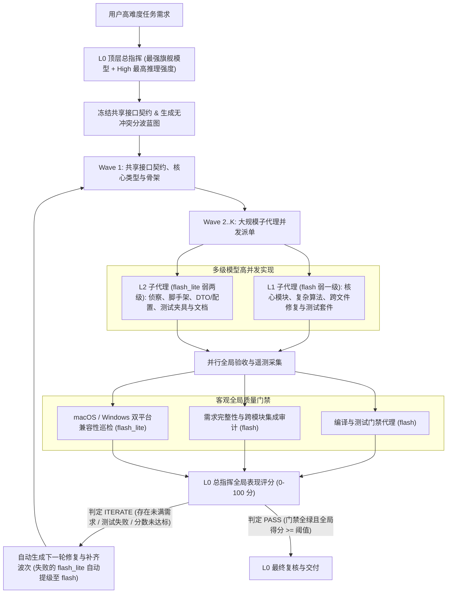

<a id="top"></a>

# Multi-Agent Skill — `apex-commander`（分层总指挥多代理自动迭代技能）

> 🌐 **语言 / Language**: **[English](./README.md)** | **简体中文**

面向 **Google Antigravity** 的跨平台（**macOS & Windows**）分层指挥与多轮全局迭代工作流技能。专为高难度系统架构设计、多模块并发开发与大规模工程重构打造：由**最强旗舰模型以最高推理强度（High）**担任**顶层架构师与总指挥（L0）**，负责制定架构契约与无冲突任务拆解，调度大量**弱一级（`flash`）**与**弱两级（`flash_lite`）**子代理高并发快速实现，并在每轮回传结果后自动结合编译测试门禁与任务全局表现打分，开启下一轮闭环迭代直至全面达标。

---

## 目录导航

- [1. 核心设计理念](#overview)
- [2. 自动多轮闭环架构图](#architecture)
- [3. 三级模型分工与自动提级策略](#model-tiers)
- [4. 快速安装指南（Windows & macOS）](#quick-start)
- [5. 如何确保该 Skill 100% 被调用？](#guarantee-invocation)
- [6. 无人值守工作流权限配置](#permissions)
- [7. macOS 与 Windows 双端兼容机制](#cross-platform)
- [8. 仓库目录结构与文件跳转](#repo-structure)
- [9. 蓝图参数说明（`blueprint.json`）](#blueprint-spec)
- [10. 如何确认 Skill 已成功运行？](#verification-signals)

---

<a id="overview"></a>
## 1. 核心设计理念

面对高复杂度工程任务时，单模型串行编写既浪费顶级推理算力又容易撑爆上下文；而普通的一次性子代理分发又经常出现接口对不上、文件互相覆盖或漏掉边界需求的问题。

`apex-commander` 通过四项机制彻底解决上述痛点：

- **好钢用在刀刃上（L0 专注架构与指挥）**：旗舰模型 + 最高推理强度（`High`）绝不浪费算力手写重复样板代码，100% 精力用于顶层架构设计、冻结共享接口契约、无冲突文件分片与全局验收决策。
- **大规模子代理高并发实现（L1 + L2 协同）**：基于 Antigravity 内置的 `run_workflow` 引擎，同时拉起大批量 `flash`（弱一级核心工程模型）与 `flash_lite`（弱两级极速轻量模型）并发完成业务代码、测试套件、DTO/配置与脚手架。
- **零文件写冲突保障**：发单前自动进行大小写不敏感路径碰撞检测与子波次切分（同时兼容 **macOS APFS** 与 **Windows NTFS**），从机制上杜绝两个并发子代理同时修改同一个文件。
- **全局表现评估与自动多轮迭代**：每轮并发实现完成后，自动并行启动**编译与测试门禁**、**需求覆盖度与集成审计**、**双系统兼容性检查**并汇总回传给总指挥；只要未达阈值（默认 `95/100`）或存在任何测试报错/需求缺口，**无需人工干预，自动规划增量任务并进入下一轮并发迭代**。

---

<a id="architecture"></a>
## 2. 自动多轮闭环架构图



---

<a id="model-tiers"></a>
## 3. 三级模型分工与自动提级策略

| 层级 | 角色定位 | `model` 配置值 | 核心职责范围 | 故障隔离与自动提级策略 |
| :--- | :--- | :--- | :--- | :--- |
| **L0** | **顶层架构师 & 总指挥** | `"inherit"` *(主会话选旗舰 High)* 或 `"pro"` | 架构设计、共享契约冻结、无冲突 DAG 分波拆解、全局多维表现打分、下一轮重规划 | 若同一难点 L1 连续受阻，由 L0 直接给出精确算法契约后再派单 |
| **L1** *(弱一级)* | **主力工程实现代理** | `"flash"` | 核心业务模块、复杂状态与算法逻辑、跨模块集成联调修复、单元与集成测试套件 | 单节点报错自动捕获隔离，绝不中断同批次其他并发子代理 |
| **L2** *(弱两级)* | **高并发极速辅助代理** | `"flash_lite"` | 代码库并行侦察、目录脚手架、DTO/类型/配置、Mock/测试夹具、CLI 包装、文档与静态巡检 | 若在当前轮失败或遗留缺陷，下一轮自动提级为 **`"flash"`** 接管 |

详细派单契约与交互回退模式说明见：[worker-prompt-contracts.md](./skills/apex-commander/references/worker-prompt-contracts.md)。

---

<a id="quick-start"></a>
## 4. 快速安装指南（Windows & macOS）

克隆本仓库后，执行对应系统的一键脚本即可安装至全局技能目录 `~/.gemini/config/skills/apex-commander`，**本机所有项目工作区立即通用**。

### Windows（PowerShell）

```powershell
git clone <你的仓库地址> C:\Users\<用户名>\Documents\GitHub\multi-agent-skill
cd C:\Users\<用户名>\Documents\GitHub\multi-agent-skill

# 标准安装（仅安装全局 Skill）
powershell -ExecutionPolicy Bypass -File .\install.ps1

# 推荐安装（同时向 ~/.gemini/config/GEMINI.md 写入高复杂度任务自动触发路由规则，保留原有配置）
powershell -ExecutionPolicy Bypass -File .\install.ps1 -WithRule
```

### macOS / Linux（`zsh` 或 `bash`）

```bash
git clone <你的仓库地址> ~/Documents/GitHub/multi-agent-skill
cd ~/Documents/GitHub/multi-agent-skill

# 标准安装（仅安装全局 Skill）
bash ./install.sh

# 推荐安装（同时向 ~/.gemini/config/GEMINI.md 写入高复杂度任务自动触发路由规则，保留原有配置）
bash ./install.sh --with-rule
```

### 其他常用管理命令

| 操作说明 | Windows (`PowerShell`) | macOS / Linux (`zsh` / `bash`) |
| :--- | :--- | :--- |
| **仅校验语法与目录完整性** | `python .\install.py --verify-only` | `bash ./install.sh --verify-only` |
| **卸载全局技能与自动路由规则** | `powershell -ExecutionPolicy Bypass -File .\install.ps1 -Uninstall` | `bash ./install.sh --uninstall` |
| **仅在单个项目内局部启用** | 将 `skills/apex-commander` 复制到 `<项目根目录>/.agents/skills/apex-commander` | 将 `skills/apex-commander` 复制到 `<项目根目录>/.agents/skills/apex-commander` |

[⬆️ 返回顶部](#top)

---

<a id="guarantee-invocation"></a>
## 5. 如何确保该 Skill 100% 被调用？

Antigravity 对 Skill 采用**渐进式按需加载（Progressive Disclosure）**机制。你可以任选或组合以下三种方式，确保遇到高难度任务时绝不漏调：

1. **方式一：直接点名或搭配 `/goal` 命令（100% 确定性触发）**
   - 在提问中直接带一句 `apex-commander` 或「指挥官模式」，长耗时大工程推荐配合 `/goal` 斜杠命令：
     ```text
     /goal 使用 apex-commander 设计并完整实现……
     ```
2. **方式二：启用全局常驻路由门禁（`-WithRule` / `--with-rule`，全自动无感防漏调）**
   - 运行安装脚本时加上 `-WithRule`（Windows）或 `--with-rule`（macOS），会自动将 [apex-commander-routing.md](./rules/apex-commander-routing.md) 以幂等标记块的形式写入全局 `~/.gemini/config/GEMINI.md`（不会覆盖你原有的其他规则）。
   - 效果：日常小问题不消耗多余 Token；一旦任务涉及 **3 个及以上模块/文件的新增或重构、系统架构设计或复杂算法工程**，常驻规则会强制要求主模型先读取并执行 `apex-commander`。
3. **方式三：中英双语触发词自动识别**
   - [SKILL.md](./skills/apex-commander/SKILL.md) 头部已内置中英文高密度触发描述（涵盖系统架构、多模块重构、「指挥官」「总指挥」「上强度」「多子代理并发」等）。

---

<a id="permissions"></a>
## 6. 无人值守工作流权限配置

在 `run_workflow` 运行期间，**后台并发子代理无法向你弹出交互式确认弹窗**——任何需要临时手动点击允许的操作都会被直接拒绝（`ToolError.denied == True`）。

为了让几十个子代理在多轮编译与测试中全自动丝滑运行，请在 **Antigravity Settings** 中确认以下配置：

1. **Model Selection（模型选择）**：选中最强旗舰模型并开启 **`(High)`** 推理强度，作为 L0 总指挥底座。
2. **Tool Execution Policy（工具执行策略）**：
   - 推荐设为 **`proceed-in-sandbox`**（工作区内命令自动在沙盒免弹窗执行）；
   - 若项目构建需要本地守护进程（如 Gradle/SBT）、端口绑定或联网拉包，可设为 **`always-proceed`**（或在进入工作流前由主代理先完成依赖安装预热）。
3. **Command Allowlist（命令白名单）**：将常用构建测试命令（`python`、`python3`、`pytest`、`node`、`npm`、`pnpm`、`cargo`、`go`、`sbt`、`gradle`、`mvn`、`dotnet`）加入允许列表。

完整权限与沙盒说明见：[cross-platform-and-permissions.md](./skills/apex-commander/references/cross-platform-and-permissions.md)。

---

<a id="cross-platform"></a>
## 7. macOS 与 Windows 双端兼容机制

弱一级/两级模型在跨系统执行终端命令时极易踩坑（例如在 Windows PowerShell 下误写 `rm -rf` / `export` / `python3`，或在 macOS 下误用 GNU `sed -i`）。本仓库已在底层全自动处理：

- **运行时系统感知与护栏注入**：[auto_orchestrator.py](./skills/apex-commander/scripts/auto_orchestrator.py) 启动时自动检测 `platform.system()`，向每一个子代理自动注入当前宿主机专属规范（Windows `PowerShell` 规范 vs. macOS `zsh/bash` 规范）。
- **自动过滤 Windows Store 空壳 `python3.exe`**：[env_probe.py](./skills/apex-commander/scripts/env_probe.py) 自动识别并剔除 Windows 下 0 字节的 `Microsoft\WindowsApps\python3.exe` 假快捷方式，准确引导 Windows 使用 `python`、macOS 使用 `python3`。
- **大小写不敏感文件系统防撞锁**：macOS 默认 APFS 与 Windows NTFS 均不区分文件名大小写，调度器在 `parallel()` 并发前会对 `owned_files` 进行统一小写归一化防撞切分。
- **跨系统换行符与执行权限保护**：[.gitattributes](./.gitattributes) 与 [install.py](./install.py) 强制保持 `.sh/.py/.md/.json` 为 `LF` 换行符、`.ps1` 为 `CRLF`，在 Windows 与 Mac 之间双向同步绝不会出现 `/bin/bash^M` 报错。

---

<a id="repo-structure"></a>
## 8. 仓库目录结构与文件跳转

```text
multi-agent-skill/
├── README.zh-CN.md                                      # 简体中文说明文档（当前页面）
├── README.md                                            # 英文说明文档 (English README)
├── install.py                                           # 跨平台安装、语法校验与全局规则注入脚本
├── install.ps1                                          # Windows PowerShell 一键安装脚本
├── install.sh                                           # macOS / Linux 一键安装脚本
├── .gitattributes                                       # 双系统 LF / CRLF 换行符保护规则
├── .gitignore                                           # Git 忽略配置
├── LICENSE                                              # MIT 开源许可证
├── .agents/
│   └── skills.json                                      # 直接在 Antigravity 打开本仓库时的技能挂载清单
├── rules/
│   └── apex-commander-routing.md                        # 可选的 GEMINI.md 常驻高复杂度任务自动触发规则模板
└── skills/
    └── apex-commander/
        ├── SKILL.md                                     # 技能核心指令文件（含中英双语触发元数据）
        ├── examples/
        │   └── blueprint_example.json                   # 多波次无冲突任务蓝图完整示例
        ├── references/
        │   ├── worker-prompt-contracts.md               # L0/L1/L2 分级调度、文件所有权契约与交互回退模式
        │   └── cross-platform-and-permissions.md        # macOS / Windows 差异矩阵与无人值守权限指南
        └── scripts/
            ├── auto_orchestrator.py                     # 基于 `run_workflow` 的多轮自动闭环编排引擎
            ├── env_probe.py                             # 跨平台系统、Shell 与编译测试工具链探测器
            ├── install_global.py                        # 技能目录独立安装器
            ├── install_mac.sh                           # 技能目录独立 macOS 安装脚本
            └── install_win.ps1                          # 技能目录独立 Windows 安装脚本
```

核心文件快捷跳转：
- 核心技能入口：[SKILL.md](./skills/apex-commander/SKILL.md)
- 自动多轮工作流引擎：[auto_orchestrator.py](./skills/apex-commander/scripts/auto_orchestrator.py)
- 跨平台环境探测器：[env_probe.py](./skills/apex-commander/scripts/env_probe.py)
- 任务拆解蓝图示例：[blueprint_example.json](./skills/apex-commander/examples/blueprint_example.json)
- 全局强制触发规则模板：[apex-commander-routing.md](./rules/apex-commander-routing.md)

[⬆️ 返回顶部](#top)

---

<a id="blueprint-spec"></a>
## 9. 蓝图参数说明（`blueprint.json`）

L0 总指挥完成架构拆解后，会生成 `blueprint.json`（参考 [blueprint_example.json](./skills/apex-commander/examples/blueprint_example.json)）并交由 [auto_orchestrator.py](./skills/apex-commander/scripts/auto_orchestrator.py) 自动迭代执行：

| 字段名 | 类型 | 默认值 | 说明 |
| :--- | :--- | :--- | :--- |
| `task_title` | `string` | 必填 | 任务标题，展示在工作流阶段面板中 |
| `user_requirements` | `string[]` | 必填 | 拆解后的全部显式与隐式需求条目（`REQ-1..N`） |
| `architecture_contract` | `string` | `""` | 模块边界、共享数据结构/函数签名、编码与跨平台统一契约 |
| `global_acceptance_criteria` | `string[]` | 内置默认标准 | 每一轮全局评估必须核验的硬性验收标准 |
| `verification_commands` | `string[]` | 自动探测 | 门禁代理每轮执行的构建、类型检查与自动化测试命令 |
| `commander_model` | `string` | `"inherit"` | `"inherit"`（继承主会话旗舰 High 模型）或强制指定 `"pro"` |
| `max_rounds` | `integer` | `3` | 自动“实现 -> 门禁审计 -> 全局评分 -> 增量修复”的最大迭代轮数 |
| `pass_score_threshold` | `integer` | `95` | 全局表现放行分数线（`0-100`，需同时满足编译测试全绿且零未完成需求） |
| `workspace_mode` | `string` | `"inherit"` | 子代理工作区模式：`"inherit"`（无冲突极速直写）、`"share"` 或 `"branch"` |
| `dry_run` | `boolean` | `false` | 设为 `true` 时仅执行波次防撞切分与配置校验，不消耗模型额度 |
| `initial_waves` | `Wave[]` | 总指挥自动生成 | 按依赖排序的多波次并发任务列表（含 `flash` / `flash_lite` 与 `owned_files`） |

---

<a id="verification-signals"></a>
## 10. 如何确认 Skill 已成功运行？

任务启动后，你在聊天界面看到以下 **3 个直观信号**，即代表 `apex-commander` 正在按多级并发闭环工作：

1. **读取技能文件**：第一步读取 `.../apex-commander/SKILL.md`。
2. **环境探测与蓝图落盘**：执行 `env_probe.py` 并生成无写冲突的 `blueprint.json`。
3. **实时多轮工作流面板**：调用 `run_workflow` 启动 `auto_orchestrator.py`，界面依次展示 `Round 1/N - Parallel Implementation`、`Global Telemetry & Verification`、`Commander Global Evaluation`，并成批弹出 `[R1][flash]`、`[R1][flash_lite]` 与 `Chief Commander` 执行卡片。

---

## 开源许可

本项目基于 [MIT License](./LICENSE) 开源发布。

[⬆️ 返回顶部](#top)
